# 컬쳐캐쉬 AI 안내
**CGV 한 곳에서 쓰는 데 최소 탭 10번, 화면 8개. 이걸 대화 한 번으로 줄입니다.**

Y-AI 메이커톤 2026 · 컬쳐랜드 사전 미션 설명 자료

| 항목 | 내용 |
|---|---|
| 클릭형 시제품 | https://kimej.github.io/cultureland-ai-guide/ |
| 시연 영상 | 별도 첨부 (2분 8초) |
| 소스 | https://github.com/KimEJ/cultureland-ai-guide |
| 적용 대상 | 컬쳐랜드 앱 **[컬쳐캐쉬] 홈** |
| 정보 기준일 | 2026-11-08 (모든 안내에 공식 출처·확인일 표기) |

---

## 1. 문제: 기능이 늘어난 만큼, 이어 붙이는 일은 이용자 몫이 됐습니다

컬쳐캐쉬로 할 수 있는 일은 많습니다. 충전 수단만 20개가 넘고, 사용 방식은 전환·바로사용·쿠폰·구글플레이·바코드 결제 5가지입니다. 하지만 이 기능들이 **각자 다른 메뉴**에 있어서, “CGV에서 쓸 수 있나?”라는 질문 하나에 답하려면 이용자가 여러 화면의 정보를 직접 이어 붙여야 합니다.

### 1-1. 지금의 이용 여정 — “CGV에서 컬쳐캐쉬로 예매하기 (잔액 0원)”

<table><tr>
<td width="33%">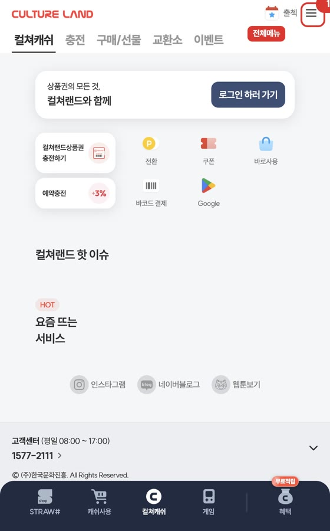 <b>① 전체메뉴</b> 홈에는 사용처 안내 입구가 없음</td>
<td width="33%">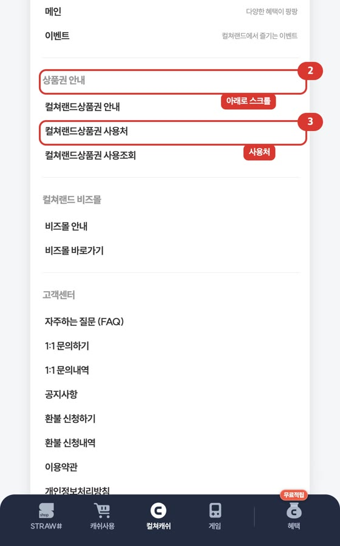 <b>② 스크롤 → ③ 사용처</b> 전체메뉴 아래쪽 ‘상품권 안내’ 안에 있음</td>
<td width="33%">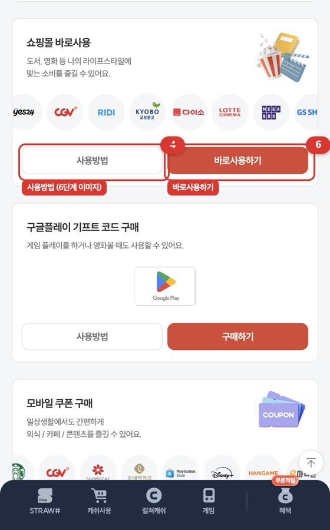 <b>④ 사용방법 → ⑥ 바로사용하기</b> 5개 카테고리 중 CGV는 로고로만 3곳에 있음</td>
</tr><tr>
<td width="33%">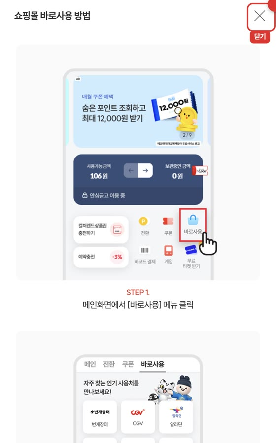 <b>⑤ 닫기</b> 사용방법은 6단계, 화면 4장 분량 팝업</td>
<td width="33%">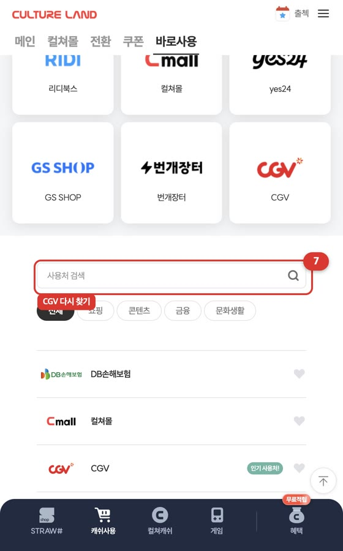 <b>⑦ CGV 다시 찾기</b> 바로사용하기는 메뉴 첫 화면으로 연결됨</td>
<td width="33%">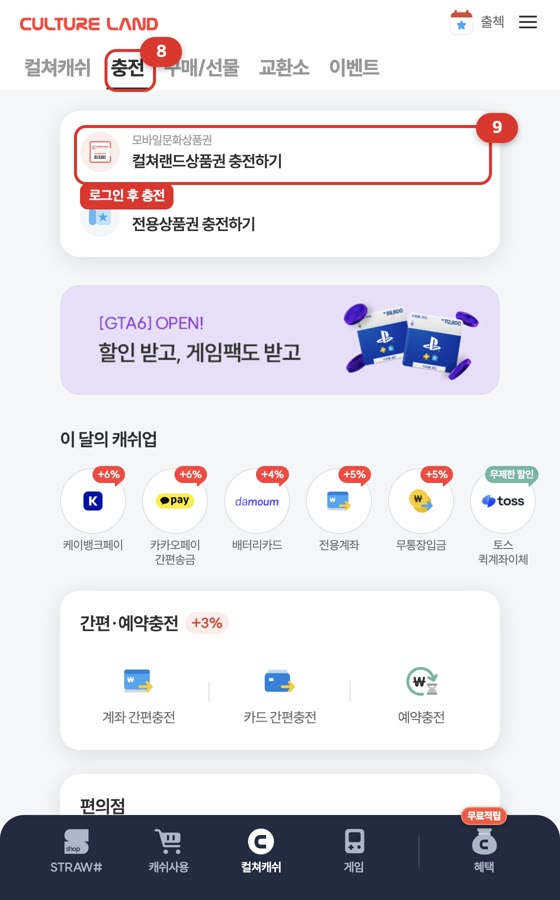 <b>⑧ 충전 → ⑨ 충전하기</b> 충전 후 다시 ⑩ 바로사용 → ⑪ CGV</td>
</tr></table>

| | 현재 | 세부 |
|---|---|---|
| 탭 수 | **최소 10번** + 메뉴 스크롤 1번 | 로그인·상품권 번호 입력 제외 |
| 거치는 화면 | **8개** | 홈 → 전체메뉴 → 사용처 → 사용방법 팝업 → 바로사용 → 충전 → 로그인·충전 → 바로사용 |
| CGV를 다시 찾는 횟수 | **2번** | 바로사용 진입 시, 충전 후 복귀 시 |
| 매장·쿠폰 방법까지 비교 | **+4번** | 카테고리마다 [사용방법] 열기·닫기 |

### 1-2. 왜 어려운가 — 구조적 원인 4가지

| 원인 | 현재 화면 |
|---|---|
| **입구가 안 보인다** | 홈 퀵메뉴 7개(상품권 충전·예약충전·전환·쿠폰·바로사용·바코드 결제·Google) 중 사용처 안내는 없음. 전체메뉴 ‘상품권 안내’ 섹션 안에 있음 |
| **한 사용처가 방법별로 흩어져 있다** | 사용처 페이지는 사용 방식 5개 카테고리로 나뉨(화면 약 3장 분량). CGV는 쇼핑몰 바로사용·모바일 쿠폰·오프라인 바코드 3곳에 **로고 이미지로만** 있어 글자 검색이 안 되고, 로고 줄은 자동으로 흘러감. 사용처 검색창은 바로사용 등 개별 메뉴 안에 있어 그 메뉴의 사용처만 찾을 수 있음 |
| **안내와 실행이 끊겨 있다** | [사용방법]은 6단계 팝업, [바로사용하기]·[구매하기]는 각 메뉴의 첫 화면으로 연결되어 CGV를 다시 찾아야 함. 오프라인 바코드 결제 카드의 버튼은 [구매하기](구매/선물 화면)로 연결 |
| **충전과 공지가 흐름 밖에 있다** | 충전 화면의 충전 수단은 20개 이상. 충전이 끝나도 보던 사용처로 돌아오지 않음. 11월 23일부터 결제 방식이 바뀌는 **안심금고 정책 변경**(본인 확인 후 찾아서 사용)은 공지사항 게시판에만 있음 |

각 메뉴는 그 자체로 잘 정리되어 있습니다. 문제는 메뉴와 메뉴 **사이**입니다. 이용자의 질문은 메뉴 단위가 아니라 “이 가게에서, 지금, 어떻게”로 들어옵니다.

---

## 2. 해결: 같은 일을, 대화 한 번으로

**컬쳐캐쉬 홈을 AI 안내 대화로 바꿉니다.** 질문하면 답변 안에서 확인 → 방법 → 충전 → 실행까지 이어집니다.

<table><tr>
<td width="25%">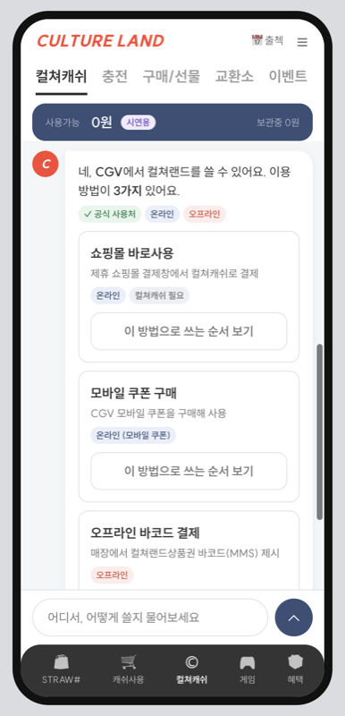 <b>① 질문 1번</b> “CGV에서 쓸 수 있어?” → 공식 사용처 ✓, 온·오프라인, 방법 3가지를 한 답변에</td>
<td width="25%">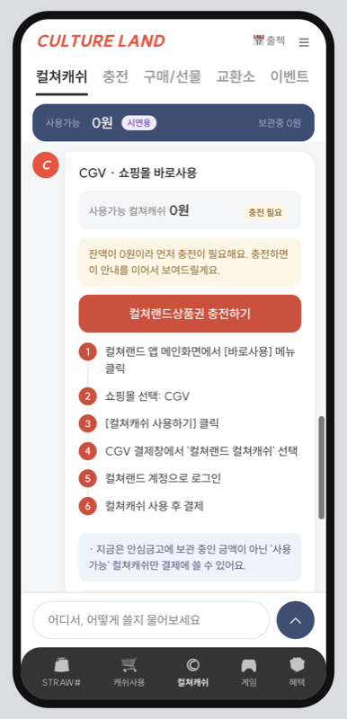 <b>② 순서 보기</b> 공식 6단계 + 잔액 확인. 0원이면 그 자리에서 충전 버튼</td>
<td width="25%">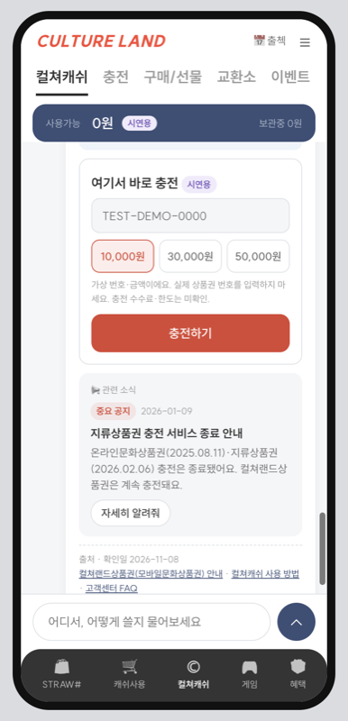 <b>③ 대화 안에서 충전</b> 공식 충전 순서와 관련 공지(지류상품권 충전 종료) 함께</td>
<td width="25%">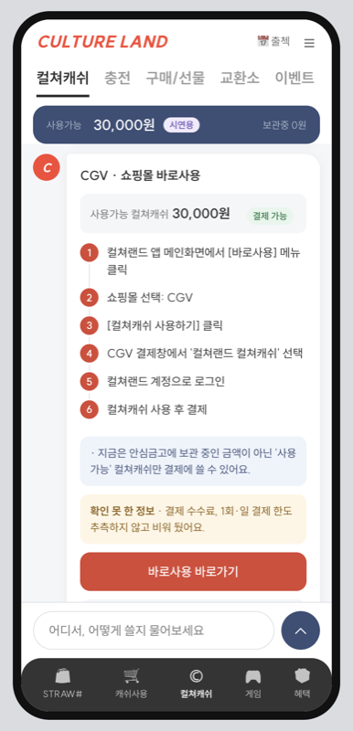 <b>④ 자동 복귀 → 실행</b> 충전 후 보던 CGV 안내로 돌아와 [바로사용 바로가기]</td>
</tr></table>

| | 현재 | 컬쳐캐쉬 AI 안내 |
|---|---|---|
| 탭 수 | 최소 10번 + 스크롤 | **5번** (전송·순서 보기·충전하기·충전·바로가기) |
| 거치는 화면 | 8개 | **1개** (대화 화면) |
| CGV 다시 찾기 | 2번 | **0번** (맥락 유지, 충전 후 자동 복귀) |
| 매장·쿠폰 방법 비교 | +4번 | **0번** (첫 답변에 3가지 모두 표시) |
| 결제 관련 공지 | 공지 게시판에서 직접 확인 | **결제 안내 바로 아래 자동 표시** |

### 설계 원칙
1. **확인 → 방법 → 실행을 한 답변에.** 사용 가능 여부를 알려주는 답변 안에 방법 카드와 다음 버튼이 함께 있습니다.
2. **맥락을 기억한다.** “매장에서도 돼?”만 물어도 직전의 CGV 기준으로 답하고, 충전이 끝나면 보던 안내로 돌아옵니다.
3. **공식 정보만 말하고, 모르는 건 모른다고 한다.** 모든 답변에 출처·확인일을 표기하고, 수수료·한도처럼 확인되지 않은 정보는 [미확인]으로 비워 둡니다.
4. **공지는 필요한 순간에.** 결제 안내에는 안심금고 변경, 충전 안내에는 지류상품권 충전 종료 공지가 자동으로 붙습니다.

---

## 3. 주요 기능

| 입력 | 예시 | 결과 |
|---|---|---|
| 사용처명·별칭 | CGV, 씨지브이, 스벅, 쿠팡 | 해당 사용처의 가능 여부·방법 |
| 카테고리·자연어 | 편의점에서 쓰려면? / 영화관 | 공식 목록 기준 후보 버튼(CU·GS25·세븐일레븐·emart24) |
| 온/오프라인 의도 | 매장에서 돼? / 바코드 | 오프라인 바코드 결제 가능 여부 우선 |
| 후속 질문 | (CGV 다음) 매장에서도 돼? | 직전 사용처 기준 답변 |
| 충전·잔액·공지 | 충전 방법 / 잔액 얼마야? / 안심금고가 뭐야 | 공식 안내 + 관련 공지 |

<table><tr>
<td width="33%">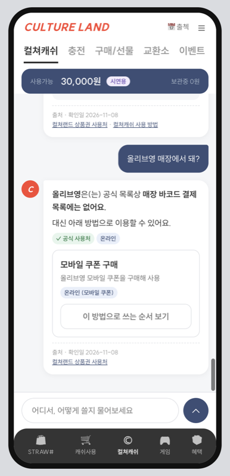 <b>정확하게 구분</b> 올리브영: 매장 바코드 결제 목록엔 없음 → 모바일 쿠폰으로 이용</td>
<td width="33%">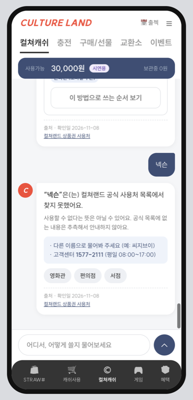 <b>모르면 모른다고</b> 목록에 없는 곳은 단정하지 않고 다른 이름·고객센터 안내</td>
<td width="33%">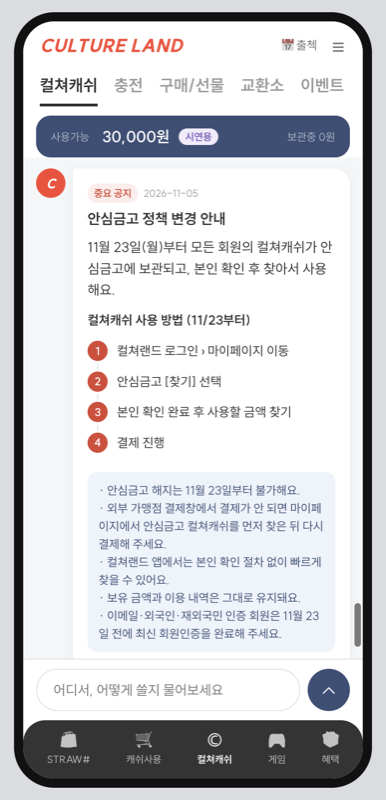 <b>공지 요약</b> 안심금고 정책 변경(11/23)과 바뀐 사용 4단계</td>
</tr></table>

데이터: 사용처 39곳(공식 사용처 페이지·전환·쿠폰 메뉴 기준), 공식 카테고리 5종과 카테고리별 공식 이용 순서, 공지 7건.

---

## 4. 앱·PC 적용 구상

| 위치 | 역할 |
|---|---|
| **앱 [컬쳐캐쉬] 홈** (주 진입) | 잔액 카드 아래를 AI 안내 대화로. 기존 퀵메뉴는 첫 메시지 안 버튼으로 유지해 기존 이용자 동선 보존 |
| 상품권 MMS의 [사용처/안내] 링크 | 상품권을 받은 직후 “어디서 쓰지?”를 바로 물을 수 있게 연결 |
| 사용처 안내 페이지 | 상단에 질문창 추가, 결과는 같은 대화로 |
| PC 웹 | 같은 대화를 오른쪽 사이드 패널로, 왼쪽 기존 화면 유지 |

**서비스 연동 지점:** 상단 잔액 줄 → 실제 사용가능·보관중 금액 / 충전 카드 → 기존 충전 화면 호출 / [바로가기] → 바로사용·바코드·전환 딥링크(사용처까지 지정) / 사용처·공지 데이터 → 사용처 관리·공지 게시판 동기화

### 확장 구상: 앱을 열기 전에 묻기 (미구현)
같은 공식 데이터와 질문 이해 로직을 앱 밖의 어시스턴트에도 연결합니다. 이용자가 가장 급한 순간은 앱 메뉴를 찾을 때가 아니라 **계산대 앞, 결제창 앞**입니다.

| 입구 | 사용 상황 | 연결 방식 |
|---|---|---|
| iPhone Siri·단축어 | 편의점 계산대에서 “시리야, 컬쳐랜드 GS25에서 돼?” → 가능 여부를 듣고 바로 앱의 상품권 바코드 화면 열기 | iOS App Intents / App Shortcuts |
| Android 기본 어시스턴트 | “컬쳐랜드로 CGV 예매하려면?” → 이용 순서 요약 + 앱의 해당 안내 화면 열기 | Android 앱 액션(App Actions) |
| 외부 AI 비서 (MCP) | ChatGPT·Claude 등에서 “컬쳐랜드상품권 어디서 써?” → 추측 대신 컬쳐랜드 공식 데이터로 답변 | MCP 서버: 사용처 검색·이용 순서·공지 조회 (읽기 전용) |

**원칙:** 어시스턴트는 사용처·이용 방법·공지 같은 **공개 정보만** 답합니다. 잔액 확인·충전·결제는 항상 앱을 열어 **본인 확인 후** 진행합니다(11월 23일 안심금고 정책과 같은 방향).

---

## 5. AI 활용 과정과 정보 출처

| 단계 | 도구 | 한 일 |
|---|---|---|
| 기획·분석 | Claude Code | 미션·심사 기준 분석, 데모 사례(CGV) 선정 |
| 공식 정보 조사 | Claude Code 리서치 에이전트 | 사용처·이용 순서·충전 규정을 공식 페이지 기준으로 수집, 출처 기록 |
| 실측·검증 | Aside 브라우저 자동화 | 현재 이용 여정 실측(1장), 디자인 값 측정, 이미지로 된 공지 본문 판독 |
| 제작·테스트 | Claude Code | 시제품 제작, 대화 흐름 24개 시나리오 자동 테스트 |

**검증하고 고친 사례**
| AI 결과 | 검증 | 수정 |
|---|---|---|
| 블로그의 “네이버페이 전환 수수료 6%, 일 10만/월 200만” | 공식 페이지에서 확인 불가 | 제외, [미확인] 표시 |
| “안심금고 금액은 결제 불가” | 2026-11-05 공지: 11/23부터 모든 캐쉬 안심금고 보관, 본인 확인 후 사용 | “지금은 / 11월 23일부터는”으로 나눠 안내, 바뀐 4단계 추가 |
| 모바일 쿠폰 구매 절차 [미확인] | 사용처 페이지 [사용방법] 팝업에서 공식 5단계 확인 | 공식 5단계 반영 |
| 올리브영·스타벅스 “매장 사용 불가” | 공식 목록엔 ‘모바일 쿠폰’에만 있고 ‘불가’ 명시 없음 | “매장 바코드 목록에 없음 + 쿠폰으로 이용”으로 변경 |
| 넥슨 “사용 불가” | 목록에 없을 뿐 불가 근거 없음 | “찾지 못함 + 고객센터”로 변경 |
| “현재 사이트엔 사용처 검색이 없다”(초기 가정) | 실측: 바로사용 메뉴에 검색창 있음 | “검색은 메뉴별로만 가능”으로 문제 정의 수정 |

**공식 출처 (확인일 2026-11-08):** 사용처·이용 순서 m.cultureland.co.kr/vchr/culturevoucherUse.do · 충전·오프라인 사용 www.cultureland.co.kr/voucher/mobile.do · 컬쳐캐쉬 사용·전환·보유한도 www.cultureland.co.kr/usecash/getCashHow.do · FAQ www.cultureland.co.kr/customer/customerMain.do · 전환 m.cultureland.co.kr/convs/convsMain.do · 공지 m.cultureland.co.kr/tgl/noticeList.do (NoteID 2387, 2350 외)

---

## 6. 구현 범위와 미구현

| 구분 | 내용 |
|---|---|
| **실제(공식) 정보** | 사용처 39곳, 카테고리 5종과 이용 순서, 충전 규정, 공지 7건 — 출처·확인일 표기 |
| **가상 시연 데이터** | 잔액, 충전 금액, 상품권 번호(TEST-DEMO-0000) — [시연용] 배지 |
| **구현** | 대화형 홈, 확인 → 방법 → 잔액 → 충전 → 자동 복귀 → 실행, 이름·별칭·카테고리·자연어·후속 질문, 결과 없음·미확인 안내, 공지 연동, 컬쳐랜드 디자인(SUIT 서체·색·카드) 적용 |
| **미구현·한계** | ① **AI 엔진은 공식 데이터 기반 규칙 응답(시뮬레이션)입니다.** LLM을 호출하지 않습니다. 정해 둔 유형 밖 질문은 “찾지 못했어요”로 답합니다. 실제 적용 시 LLM을 쓰더라도 이 공식 데이터 안에서만 답하도록 제한하는 구조를 제안합니다. ② 수수료·한도·편의점 제외 품목·앱 바코드 결제 세부 절차는 로그인이 필요한 페이지라 [미확인]. ③ 결제·충전·계정·실제 잔액 연동 없음. ④ 사용처는 공개 페이지 기준 39곳(공식 안내상 전체 3천여 곳). ⑤ 메인 배너·이벤트 연동 미구현. ⑥ Siri·Android 어시스턴트·MCP 연동은 구상 단계 |
